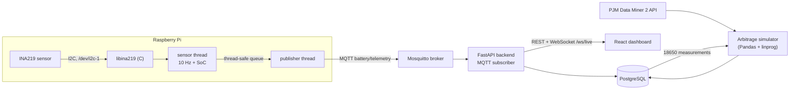
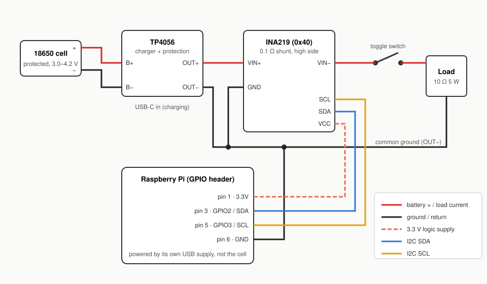
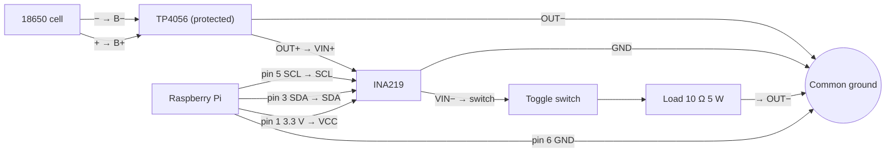

# Battery Telemetry & Power Market Arbitrage Simulator


A Raspberry Pi measures a real lithium-ion cell, and a simulator asks what a
battery like it could earn trading on the PJM electricity market.

- **Telemetry:** a C library reads an INA219 current/voltage sensor register by
  register over I2C. A multithreaded C++ program samples it at 10 Hz, estimates
  state of charge by coulomb counting, and publishes JSON over MQTT.
- **Backend:** FastAPI subscribes to MQTT, validates each message with Pydantic,
  stores it in PostgreSQL, and serves REST endpoints plus a live WebSocket.
- **Dashboard:** React + TypeScript (Vite, Recharts) with live cards, live charts
  and an arbitrage panel.
- **Arbitrage:** Pandas simulator on PJM hourly LMPs: a daily threshold strategy
  compared with a perfect-foresight linear program (`scipy.optimize.linprog`).
- **CI:** GoogleTest and pytest on every push (GitHub Actions), plus a dashboard
  type check and build.

Stack: C99, C++17, Python 3.11, SQL (PostgreSQL 16), TypeScript, MQTT (Mosquitto).

---

## Contents

1. [Architecture](#architecture)
2. [Repository layout](#repository-layout)
3. [Hardware](#hardware): bill of materials, schematic, wiring, safety
4. [Quick start on a laptop (no hardware)](#quick-start-on-a-laptop-no-hardware)
5. [Raspberry Pi setup](#raspberry-pi-setup)
6. [PJM arbitrage simulator](#pjm-arbitrage-simulator)
7. [API reference](#api-reference)
8. [Tests and CI](#tests-and-ci)
9. [Troubleshooting](#troubleshooting)
10. [Design notes and limitations](#design-notes-and-limitations)

---

## Architecture



Each telemetry message looks like this:

```json
{"timestamp":"2026-10-28T17:36:01.123Z","bus_voltage_v":3.9124,"shunt_voltage_mv":38.210,
 "current_ma":382.10,"power_mw":1494.00,"soc_pct":97.425}
```

## Repository layout

| Path | What it is |
|---|---|
| `libina219/` | C99 static library: i2c-dev register I/O, pure conversion math, mock backend. `ina219_read` CLI for checking wiring. |
| `telemetry/` | C++17 program: sensor thread, publisher thread, bounded queue, coulomb counter, libmosquitto client. |
| `backend/` | FastAPI app, Pydantic validation, SQLAlchemy Core queries, paho-mqtt subscriber. |
| `dashboard/` | React + TypeScript + Recharts, built with Vite. |
| `arbitrage/` | PJM price loader, battery model, strategies, chart and database output. |
| `db/schema.sql` | PostgreSQL schema (`readings`, `arbitrage_runs`, `arbitrage_results`). |
| `deploy/` | systemd units for the Pi, Mosquitto config. |
| `docs/wiring.svg` | Wiring diagram. |
| `CMakeLists.txt` | Builds the C library, the telemetry program and the GoogleTest suites. |

---

## Hardware

### Bill of materials

Prices are rough US retail figures (late 2026) and vary by seller.

| Part | Notes | Approx. price |
|---|---|---|
| Raspberry Pi 4 (2 GB) | A 3B+ or Zero 2 W also works. Use 64-bit Raspberry Pi OS. | $45 (Zero 2 W: $15) |
| microSD card, 32 GB | For Raspberry Pi OS | $8 |
| Pi power supply | Official USB-C 5.1 V 3 A for a Pi 4 | $8 |
| INA219 breakout | 0.1 Ω shunt, address 0x40 (Adafruit #904 or a generic board) | $3–10 |
| Protected 18650 Li-ion cell | Must have a built-in protection circuit; buy from a reputable seller | $8–12 |
| 18650 holder | Single cell, with leads | $2 |
| TP4056 charger module, USB-C, **with protection** | The 6-pad version (IN, B+/B−, OUT+/OUT−) with the DW01 protection chip | $1–2 |
| 10 Ω 5 W power resistor | Draws about 0.4 A from a full cell (≈1.7 W) and gets warm | $1 |
| SPST toggle switch | Rated for at least 1 A | $2 |
| Breadboard, jumper wires, 22 AWG hook-up wire | | $8 |
| **Total** | | **≈ $85 with a Pi 4** |

A small 3–5 V DC motor or a short LED strip can replace the resistor.

### Circuit schematic

The INA219 sits on the **high side**: in series between the battery's positive
terminal (via the TP4056's protected output) and the load. Every milliamp the
load draws flows through the 0.1 Ω shunt from VIN+ to VIN−.

[`docs/wiring.svg`](docs/wiring.svg):



### Pin-by-pin wiring

| From | To | Wire | Purpose |
|---|---|---|---|
| 18650 + | TP4056 **B+** | red | cell to charger/protection |
| 18650 − | TP4056 **B−** | black | |
| TP4056 **OUT+** | INA219 **VIN+** | red | protected battery + into the shunt |
| INA219 **VIN−** | toggle switch (one side) | red | shunt out toward the load |
| toggle switch (other side) | load + | red | |
| load − | TP4056 **OUT−** | black | return path |
| INA219 **GND** | TP4056 **OUT−** | black | common ground |
| Pi **pin 6** (GND) | TP4056 **OUT−** (or INA219 GND) | black | common ground |
| Pi **pin 1** (3.3 V) | INA219 **VCC** | orange | sensor logic supply |
| Pi **pin 3** (GPIO2 / SDA) | INA219 **SDA** | blue | I2C data |
| Pi **pin 5** (GPIO3 / SCL) | INA219 **SCL** | yellow | I2C clock |

Leave the INA219's A0/A1 address jumpers open for address 0x40. The breakout
already has I2C pull-up resistors; the Pi has its own too, and that is fine.



### What the sensor actually measures

- **Bus voltage** is VIN− to GND: the voltage the load sees. The cell's terminal
  voltage is bus voltage + shunt voltage.
- **Current** is positive when the cell discharges into the load. With this
  wiring, charging current from the TP4056 goes straight into the cell through
  B+/B− and does **not** pass through the INA219, so the coulomb counter only
  sees discharge. After a full charge, restart the telemetry program with
  `--initial-soc 100` to re-anchor the state of charge.

### Safety

- **Use protected cells only**, with a TP4056 module that has the protection chip
  (DW01 + MOSFETs). Unprotected Li-ion cells can be over-discharged or shorted.
- **Never short the battery.** Wire everything with the cell out of its holder,
  and put it in last. Keep bare leads apart; a shorted 18650 can deliver tens of
  amps and start a fire.
- **INA219 limits (0.1 Ω shunt):** at most **26 V** on VIN+/VIN−, and about
  **±3.2 A** before the ±320 mV shunt range saturates. This project stays far
  below both (4.2 V, ~0.4 A).
- **Common ground is required.** The INA219 measures bus voltage against its
  GND pin, and I2C signals are referenced to it. Without a shared ground
  between the battery circuit, the INA219 and the Pi, readings are garbage.
- **Power the INA219 from 3.3 V (pin 1), never 5 V**, so its I2C lines stay at
  the Pi's 3.3 V logic level.
- **Do not power the Pi from the cell.** It runs from its own USB supply.
- **Don't charge unattended.** Charge on a non-flammable surface, away from
  anything that can burn, and disconnect when charging is done. Stop using a
  cell that gets hot, swells or is dented.
- The 10 Ω resistor dissipates up to ~1.8 W and gets hot. Mount it in free air.

---

## Quick start on a laptop (no hardware)

Everything runs in Docker, with the telemetry program in `--mock` mode
(the mock simulates the cell, the shunt and a load that switches on for 20 s and
off for 10 s).

```bash
git clone https://github.com/Vishwadeep-Balakrishnan/battery-telemetry.git
cd battery-telemetry
cp .env.example .env
docker compose up --build
```

Open **http://localhost:8080**. Within a few seconds the status shows *Live*
and the cards and charts update.

Fill the arbitrage panel (uses the bundled sample prices unless `PJM_API_KEY`
is set in `.env`), then press *Refresh* on the dashboard:

```bash
docker compose run --rm arbitrage
# or another range / market:
docker compose run --rm arbitrage --start 2026-10-01 --end 2026-10-07 --node PECO --market rt
```

| Service | Port | |
|---|---|---|
| dashboard (nginx) | 8080 | proxies `/api`, `/health`, `/ws` to the backend |
| backend (FastAPI) | 8000 | interactive docs at http://localhost:8000/docs |
| mosquitto | 1883 | `mosquitto_sub -h localhost -t battery/telemetry` to watch the raw stream |
| postgres | 5432 | user/password/db `battery` (change in `.env`) |

### Without Docker

```bash
# C/C++ (needs cmake, g++, pkg-config, libmosquitto-dev)
cmake -S . -B build && cmake --build build -j && ctest --test-dir build

# Python 3.11
python3 -m venv .venv && source .venv/bin/activate
pip install -r backend/requirements.txt -r arbitrage/requirements.txt -r requirements-dev.txt
pytest

# Dashboard (Node 20+)
cd dashboard && npm ci && npm run dev    # http://localhost:5173, proxies to localhost:8000
```

---

## Raspberry Pi setup

Two ways to deploy. In both, the **telemetry program runs natively on the Pi**.

- **Option A (recommended):** Pi runs only the telemetry program; Mosquitto,
  PostgreSQL, backend and dashboard run in Docker on a laptop or server on the
  same network.
- **Option B:** everything runs on the Pi.

### 1. Prepare the Pi

Flash **Raspberry Pi OS (64-bit, Bookworm)** with Raspberry Pi Imager, set a
username, enable SSH, and connect it to your network.

```bash
sudo apt update && sudo apt full-upgrade -y
sudo apt install -y git cmake g++ pkg-config libmosquitto-dev i2c-tools mosquitto-clients
```

### 2. Enable I2C

```bash
sudo raspi-config
#   3 Interface Options → I5 I2C → Yes
sudo reboot
```

After the reboot, check that `/dev/i2c-1` exists and your user can use it:

```bash
ls -l /dev/i2c-1          # crw-rw---- root i2c
groups                    # should include i2c; if not:
sudo usermod -aG i2c $USER && sudo reboot
```

### 3. Wire the circuit and check the sensor

Wire as in [the table above](#pin-by-pin-wiring), cell inserted last. Then:

```bash
i2cdetect -y 1
```

You should see `40` in the grid:

```
     0  1  2  3  4  5  6  7  8  9  a  b  c  d  e  f
00:                         -- -- -- -- -- -- -- --
...
40: 40 -- -- -- -- -- -- -- -- -- -- -- -- -- -- --
...
```

### 4. Build and check a reading

```bash
git clone https://github.com/Vishwadeep-Balakrishnan/battery-telemetry.git
cd battery-telemetry
cmake -S . -B build -DCMAKE_BUILD_TYPE=Release
cmake --build build -j4
ctest --test-dir build          # unit tests, no hardware needed

./build/libina219/ina219_read   # one reading from the real sensor
```

With the switch **on** and a charged cell you should see roughly 3.9–4.1 V,
380–410 mA and 1.5–1.7 W. With the switch **off**, current should be within a
few mA of zero.

> First build: CMake downloads GoogleTest from GitHub. Add `-DBUILD_TESTS=OFF`
> to skip the tests on a slow Pi Zero 2 W.

### 5. Run the telemetry program

Try it in the foreground first:

```bash
./build/telemetry/battery_telemetry --host <broker-host>
# in another terminal:
mosquitto_sub -h <broker-host> -t battery/telemetry
```

`<broker-host>` is `localhost` for Option B, or the IP of the machine running
Docker for Option A. All flags:

```
--host HOST            broker host (default localhost)
--port PORT            broker port (default 1883)
--topic TOPIC          topic (default battery/telemetry)
--rate-hz HZ           sample rate (default 10)
--capacity-mah MAH     battery capacity for SoC (default 2500)
--initial-soc PCT      SoC at start, 0-100 (default 100)
--mock                 fake readings, no hardware needed
--bus PATH             I2C bus device (default /dev/i2c-1)
--address ADDR         INA219 address (default 0x40)
--shunt-ohms OHMS      shunt resistor (default 0.1)
--max-current AMPS     expected max current for calibration (default 2.0)
```

Set `--capacity-mah` to your cell's rated capacity.

### 6. Start it on boot (systemd)

```bash
sudo cmake --install build                       # → /usr/local/bin/battery_telemetry
sudo cp deploy/systemd/battery-telemetry.service /etc/systemd/system/
sudo cp deploy/systemd/battery-telemetry.env /etc/default/battery-telemetry
sudo nano /etc/default/battery-telemetry          # set --host, --capacity-mah
sudo nano /etc/systemd/system/battery-telemetry.service   # set User= to your username
sudo systemctl daemon-reload
sudo systemctl enable --now battery-telemetry
journalctl -u battery-telemetry -f
```

### 7a. Option A: rest of the stack on another machine

On the laptop/server (same network as the Pi):

```bash
cp .env.example .env
docker compose up --build mosquitto db backend dashboard     # no mock telemetry
```

Point the Pi at it: `--host <laptop-ip>` in `/etc/default/battery-telemetry`,
then `sudo systemctl restart battery-telemetry`. Open `http://<laptop-ip>:8080`.

The provided Mosquitto config listens on all interfaces; if the Pi still can't
connect, check the laptop's firewall allows TCP 1883.

### 7b. Option B: everything on the Pi

Docker works on a 64-bit Pi 4 (all images used are multi-arch):
`docker compose up --build mosquitto db backend dashboard`. Or natively:

```bash
sudo apt install -y mosquitto postgresql python3-venv nodejs npm
sudo cp deploy/mosquitto/mosquitto.conf /etc/mosquitto/conf.d/battery.conf
sudo systemctl restart mosquitto

# Database
sudo -u postgres psql -c "CREATE USER battery WITH PASSWORD 'battery';"
sudo -u postgres psql -c "CREATE DATABASE battery OWNER battery;"
PGPASSWORD=battery psql -h localhost -U battery -d battery -f db/schema.sql

# Backend
python3 -m venv .venv
.venv/bin/pip install -r backend/requirements.txt -r arbitrage/requirements.txt
cp .env.example .env                              # defaults point at localhost
sudo cp deploy/systemd/battery-backend.service /etc/systemd/system/
sudo nano /etc/systemd/system/battery-backend.service  # fix User= and paths
sudo systemctl daemon-reload && sudo systemctl enable --now battery-backend
curl localhost:8000/health

# Dashboard: build once, then serve with the same proxy as in dev
cd dashboard && npm ci && npm run build
npx vite preview --host --port 8080               # http://<pi-ip>:8080
```

A Pi 4 handles this comfortably. On a Pi Zero 2 W (512 MB RAM), prefer Option A.

---

## PJM arbitrage simulator

### What it does

1. Loads hourly locational marginal prices (LMPs, $/MWh) for a pricing node.
2. Runs two strategies on the same battery:
   - **Threshold:** each day, charge at full power in the `k` cheapest hours and
     discharge in the `k` most expensive hours (skipping days whose spread
     doesn't cover the round-trip loss).
   - **Perfect-foresight LP:** a linear program that knows every price in
     advance. It is an upper bound no real strategy can beat.
3. Prints total profit, equivalent full cycles and profit per cycle; saves a
   chart to `arbitrage/output/`; stores the threshold run in PostgreSQL for
   the dashboard (when `DATABASE_URL` is set).

Battery model: energy bought is `+`, sold is `−`. Round-trip efficiency is split
evenly between charging and discharging (√η each way). SoC stays within
`[min_soc, max_soc]` of capacity; both strategies start at `min_soc`.

```bash
python -m arbitrage.run --start 2026-10-01 --end 2026-10-07 --node PECO
```

```
Prices:  168 hours of DA LMP at PECO from bundled SYNTHETIC sample (set PJM_API_KEY for real prices)
Battery: 13.5 kWh, 5 kW, 90% round trip, SoC 10%-95% (default)
Threshold (k=3): profit $2.4120, 7.00 cycles, $0.3446/cycle
Perfect foresight LP: profit $2.7708, 14.90 cycles
Threshold captures 87% of the LP bound
Chart:   arbitrage/output/arbitrage_PECO_da_2026-10-01_2026-10-07.png
Database: saved as run 1
```

Useful flags: `--market rt` (real-time instead of day-ahead), `--k 4`,
`--capacity-kwh`, `--power-kw`, `--efficiency`, `--min-soc`, `--max-soc`,
`--offline` (never call the API), `--no-db`, `--pnode-id` (filter by numeric
pnode id instead of name). `python -m arbitrage.run --help` lists everything.

### Connecting the hardware to the simulation

`--battery hardware` sizes the battery from the 18650 readings in the database:

```bash
python -m arbitrage.run --start 2026-10-01 --end 2026-10-07 --battery hardware --cells 1500
```

- **Capacity** = rated Ah (`--rated-mah`, default 2500) × the cell's median
  terminal voltage under load (bus + shunt voltage), × `--cells`.
- **Efficiency** comes from the voltage sag: discharge efficiency ≈
  V_loaded / V_rest, and round trip ≈ its square (assuming charging loses about
  the same). This only captures resistive loss in the cell, so it is optimistic.
- **Power** = capacity × `--c-rate` (default 0.5C).

Before using it, record a few minutes of telemetry while toggling the load
switch on and off, so there are both "at rest" and "under load" samples.
A single cell is about 9 Wh, so `--cells` scales it up to a pack whose profit is
readable in dollars rather than fractions of a cent.

### Getting a PJM API key

Data Miner 2 is free, but needs a PJM account:

1. Create an account in PJM's account manager (linked from the Data Miner 2
   page on pjm.com) and request access to **Data Miner 2 / API Portal**.
2. Sign in to the PJM API portal, open **Products**, and subscribe to the
   Data Miner 2 API.
3. Your key is on your profile under **Your Subscriptions** (primary key).
4. Put it in `.env` as `PJM_API_KEY=...`, or `export PJM_API_KEY=...`.

With a key set, downloaded prices are cached as CSV in `arbitrage/data/cache/`
and reused on later runs. Without a key, the simulator uses
`arbitrage/data/sample_prices_synthetic.csv`.

> **The bundled sample is synthetic.** It is shaped like a shoulder-season PJM
> East week (overnight trough, evening peak, weekend dip; the RT series has a
> few spikes and negative hours) for PECO, 2026-10-01 to 2026-10-07, day-ahead
> and real-time. It exists so the simulator, the dashboard and CI work without a
> key or network. Use a real key for real conclusions.

### PJM API details, and what to double-check

The client in `arbitrage/prices.py` follows PJM's Data Miner 2 API guide:

| Item | Value used |
|---|---|
| Base URL | `https://api.pjm.com/api/v1/` |
| Day-ahead feed | `da_hrl_lmps`, price field `total_lmp_da` |
| Real-time feed | `rt_hrl_lmps`, price field `total_lmp_rt` |
| Auth header | `Ocp-Apim-Subscription-Key: <PJM_API_KEY>` |
| Date filter | `datetime_beginning_ept=MM/DD/YYYY HH:mmtoMM/DD/YYYY HH:mm` |
| Node filter | `pnode_name=PECO` (or `pnode_id=` via `--pnode-id`) |
| Other params | `row_is_current=TRUE`, `fields=…`, `rowCount=50000`, `startRow` paging |
| Response | JSON with `items` and `totalRows` |

I couldn't call the live API while building this (no key), so verify on your
first real run:

- That `pnode_name=PECO` returns the PECO **zone** rows. If it returns nothing
  or several pnodes, look up the zone's numeric id in Data Miner 2 and pass
  `--pnode-id <id>`. (When a name matches several pnodes, the loader keeps the
  first price per hour.)
- Field names, with a quick request to the feed's metadata endpoint, e.g.
  `https://api.pjm.com/api/v1/da_hrl_lmps/metadata`.
- **Archived data:** these feeds archive after about two years. Archived
  queries only allow date, `type`, `row_is_current` and `version_nbr` filters,
  and the start and end must be in the same calendar year, so the node filter
  above won't work for old dates.

---

## API reference

All endpoints are `GET`. Times are ISO 8601; responses are UTC.

| Endpoint | Returns |
|---|---|
| `/health` | `{"status","database","mqtt_connected"}` |
| `/api/readings/latest` | newest reading (404 if none yet) |
| `/api/readings?start=&end=&limit=` | readings in the window, oldest first; without a window, the newest `limit` (default 1000, max 10000) |
| `/api/stats?start=&end=` | min/max/avg voltage and current, sample count, and energy in Wh (trapezoid integration of power; gaps over 5 s are skipped). Default window: last hour. |
| `/api/arbitrage/latest` | latest simulator run summary and its hourly schedule (404 if none) |
| `/ws/live` (WebSocket) | every new reading as JSON, as soon as it is stored |
| `/docs` | interactive OpenAPI docs |

Backend configuration (environment variables, see `.env.example`):
`DATABASE_URL`, `MQTT_ENABLED`, `MQTT_HOST`, `MQTT_PORT`, `MQTT_TOPIC`,
`CORS_ORIGINS`.

---

## Tests and CI

| Suite | Covers | Run |
|---|---|---|
| GoogleTest `ina219_tests` | big-endian byte handling, calibration value, current LSB, shunt/bus/current/power conversions (sign, status bits), mock backend end to end | `ctest --test-dir build` |
| GoogleTest `telemetry_tests` | queue FIFO, drop-oldest, close/wake-up, 20k-item producer/consumer; SoC integration, clamping, charging; JSON/timestamp format; CLI parsing | `ctest --test-dir build` |
| pytest `backend/tests` | Pydantic validation (ranges, NaN, missing fields, timezone), every endpoint on SQLite, WebSocket push, CORS, schema.sql ↔ SQLAlchemy sync | `pytest backend` |
| pytest `arbitrage/tests` | SoC and power limits, efficiency arithmetic, threshold ≤ LP bound, sample CSV, PJM client paging (mocked), hardware sizing, CLI → database → backend read-back | `pytest arbitrage` |

No test needs hardware, a broker or a network: the C tests use the pure math
and the mock backend, backend tests use SQLite, and arbitrage tests replace
`requests.get` with a function that fails if called.

`.github/workflows/ci.yml` runs on every push and pull request: CMake build +
GoogleTest, pytest on Python 3.11, and `npm ci` → type check → build for the
dashboard. CI never calls the PJM API.

---

## Troubleshooting

**`i2cdetect -y 1` shows nothing at 0x40**
- I2C not enabled: rerun `raspi-config`, reboot, check `/dev/i2c-1` exists.
- SDA and SCL swapped (pin 3 is SDA, pin 5 is SCL), or VCC not on 3.3 V.
- No common ground between the Pi and the INA219.
- Address jumpers bridged: the board then answers at 0x41, 0x44 or 0x45; pass
  `--address 0x41` (etc.).

**`cannot open /dev/i2c-1: Permission denied`**
Add your user to the `i2c` group (`sudo usermod -aG i2c $USER`) and log in again.

**`cannot open /dev/i2c-1: No such file or directory`**
I2C is disabled. Enable it in `raspi-config` and reboot.

**Current reads zero**
- The switch is off, or the load isn't in the loop.
- The INA219 isn't in series: both the load and the battery are on VIN+ (or the
  load returns through VIN−). Current must flow *into* VIN+ and *out of* VIN−.
- After a brown-out the chip forgets its calibration; the driver rewrites it
  before every current read, so this recovers by itself on the next sample.

**Current is negative**
VIN+ and VIN− are swapped. Swap the two wires.

**Bus voltage is ~0 V or nonsense, current looks right**
The INA219's GND isn't tied to the battery/load ground (OUT−).

**Log says `math overflow flag set`**
Current exceeded the calibrated range. Raise `--max-current` (up to 3.2) or
check for a short.

**Telemetry: `mqtt: connection lost, reconnecting` repeating**
- Wrong `--host`, or the broker isn't running (`systemctl status mosquitto`).
- Mosquitto 2.x only listens on localhost by default. Install
  `deploy/mosquitto/mosquitto.conf` (it adds `listener 1883 0.0.0.0`).
- Firewall on the broker machine blocking TCP 1883.
Test from the Pi with `mosquitto_sub -h <host> -t '#' -v`. The program keeps
retrying and buffers up to ~10 minutes of readings, then drops the oldest.

**Dashboard says "Backend offline"**
The backend isn't reachable through the dashboard's proxy. Check
`curl localhost:8000/health`, and in dev set `BACKEND_URL` if the backend runs
elsewhere (`BACKEND_URL=http://pi.local:8000 npm run dev`).

**Dashboard says "Connected, no readings"**
The backend is up but nothing is arriving. Check `/health` → `mqtt_connected`,
the telemetry service (`journalctl -u battery-telemetry`), and that both sides
use the same topic.

**Arbitrage panel says "No simulator runs yet"**
Run the simulator with `DATABASE_URL` set (or `docker compose run --rm arbitrage`),
then press Refresh.

**Simulator: `no prices for ...`**
Without `PJM_API_KEY`, only the sample range (PECO, 2026-10-01 to 2026-10-07)
is available. Set the key, or use those dates.

**Simulator: `PJM rejected the API key`**
Check the key is the subscription's primary key and that your Data Miner 2
subscription is approved.

**SoC drifts from reality**
Coulomb counting accumulates error and doesn't see charging in this wiring.
After a full charge: `sudo systemctl restart battery-telemetry` (with
`--initial-soc 100`).

---

## Design notes and limitations

- **Threads, not async:** the sensor thread never blocks on the network. If the
  broker is down, readings wait in a bounded queue (6000 ≈ 10 minutes at 10 Hz)
  and the oldest are dropped first. libmosquitto's own network thread handles
  reconnects with exponential backoff (1 s to 30 s).
- **Timing:** the sensor loop uses `sleep_until` on a steady clock, so the rate
  doesn't drift, and the SoC integrates the *measured* time between samples.
- **Calibration:** for 0.1 Ω and 2 A, `Cal = trunc(0.04096 / (2/32768 × 0.1)) = 6710`.
  The driver then uses the effective LSB of the value actually programmed
  (61.04 µA/bit) so readings stay exact. The chip is configured for a 16 V bus
  range and ±320 mV shunt range (12-bit, continuous; config register `0x199F`).
- **Mock mode** produces raw register values, so it exercises the same
  conversion code as the real sensor.
- **The LP bound may charge and discharge in the same hour when prices are
  negative** (it gets paid to burn energy in losses). That is allowed because it
  is an upper bound, not a schedule to follow.
- **Hourly resolution:** the simulator treats each price row as one hour. It
  doesn't model degradation, ancillary services, or market rules for actually
  bidding a battery into PJM.

## License

MIT, see [LICENSE](LICENSE).
